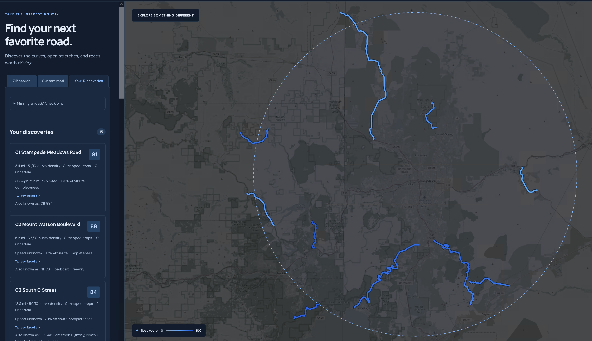
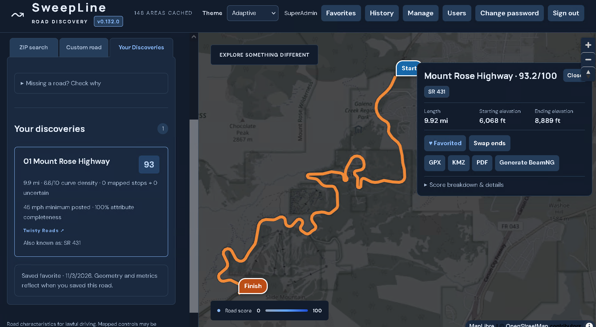
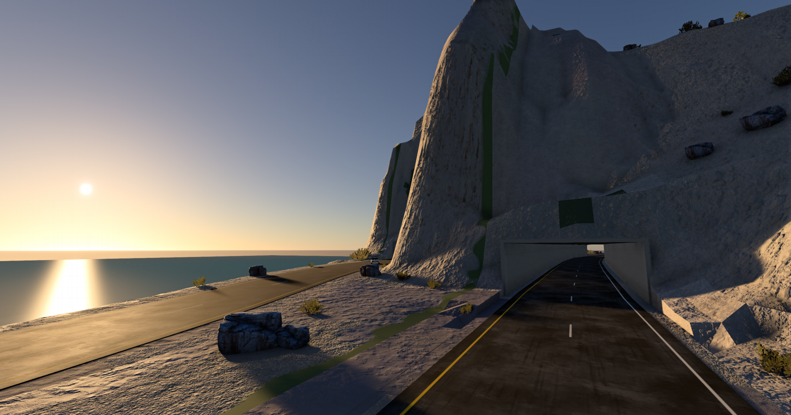
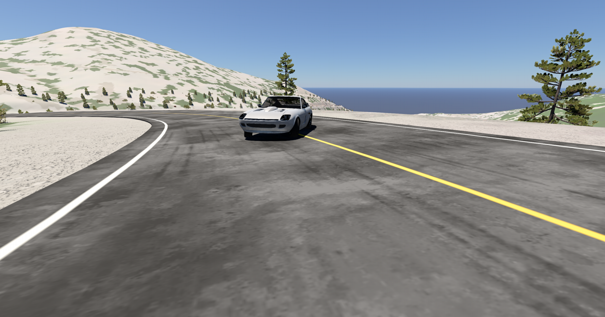
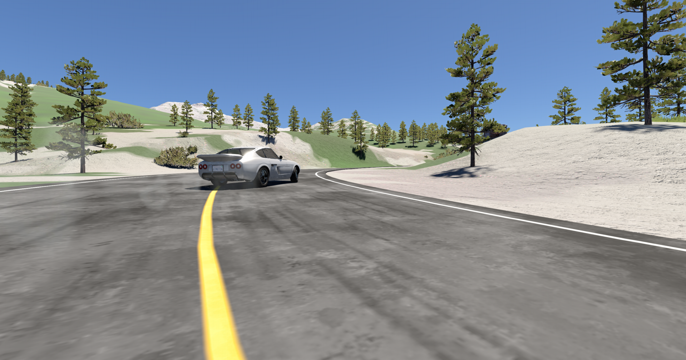
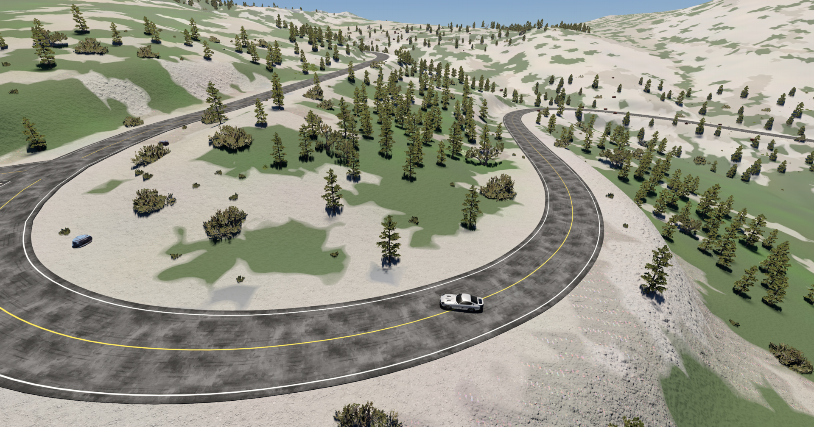
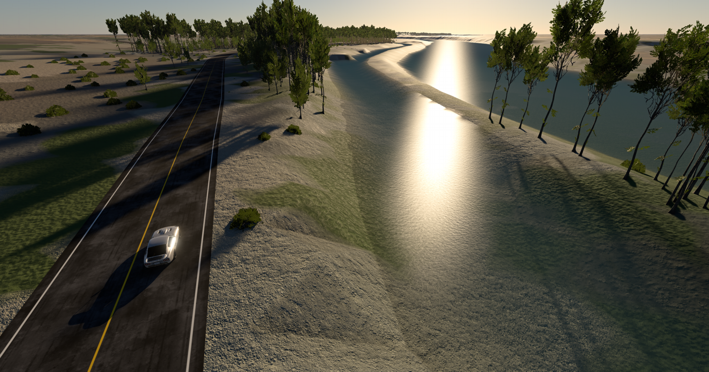

# SweepLine

<p align="center">
  
</p>

SweepLine is a self-hosted road discovery tool for automotive enthusiasts. Find and compare continuous driving roads near a US ZIP code, or select your own stretch on an interactive map.

## Install

On Debian 12+ with systemd, run from a trusted checkout:

```bash
sudo ./setup.sh
```

Press Enter to use the default port, **1279**, or choose another available port. On first installation, the terminal prompts you to create the **superadmin** password; no email address is required.

Open `http://YOUR_SERVER:1279` (or your chosen port) and sign in as **superadmin**. SweepLine automatically prepares ZIP coordinates and downloads road data as needed. No manual geographic imports are required.

The installer reuses existing services and creates isolated application resources under `/var/www/sweepline`. To update, run the same command from an updated checkout; existing configuration, accounts and road data are preserved.

If executable permissions were lost, run `chmod +x setup.sh` first. See [installation details](docs/installation.md) for dependencies, configuration and password recovery.





## Features

- **Road discovery:** Twisty Roads and Open Highways profiles, ZIP/map location selection, radius searches, and advanced length, curve, surface and stop filters.
- **Custom roads:** choose connected start and finish points directly on the map.
- **Interactive map:** ranked roads, scores and metrics, alternate names, and reversible start/finish orientation.
- **Visible progress:** staged search/export progress and colored map regions showing data preparation.
- **History and favorites:** private saved roads with map thumbnails and reusable searches.
- **Road exports:** GPX, KMZ and printable PDF maps with geometry-based bend notes.
- **BeamNG.drive exports:** playable road maps with estimated terrain, stock trees/grass and asphalt detail, mapped lakes/rivers, structures, intersections, start/finish spawns and forward/reverse time trials; downloaded source resources are cached for one week.
- **Account management:** SuperAdmin, Admin and User roles, configurable password policies, password changes and session timeouts.
- **Server management:** background job monitoring, cancellation/retries, storage controls and a map for refreshing or discarding regional road data.
- **Adaptive appearance:** automatic light/dark mode with manual theme selection.











SweepLine discovers roads rather than providing turn-by-turn navigation. Road data and exported simulations are estimates; verify real access and conditions before driving.

Detailed guides, operations, API and development references are in [docs](docs/README.md). Application code is [MIT licensed](LICENSE).
